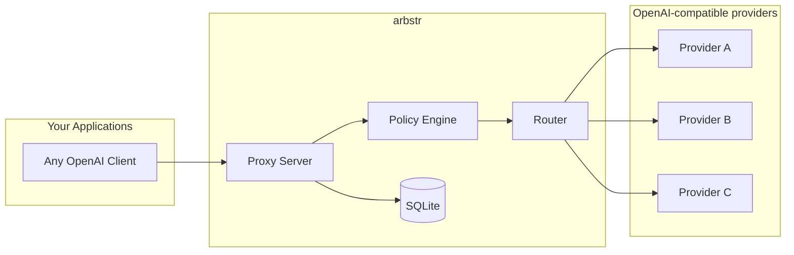
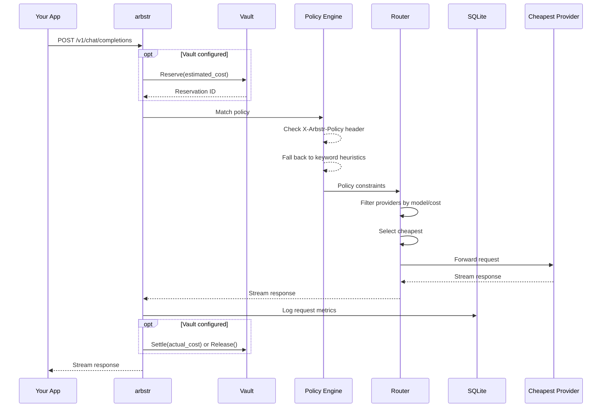

# Development Guide

This document covers arbstr's architecture, internals, and development workflow. For user-facing documentation (installation, usage), see [README.md](./README.md). For contribution guidelines, see [CONTRIBUTING.md](./CONTRIBUTING.md).

## Project Overview

arbstr is an intelligent LLM routing and cost optimization layer. It acts as an OpenAI-compatible proxy between your applications and any OpenAI-compatible providers (Routstr, OpenRouter, Anthropic, mesh-llm, Ollama, ...), selecting the cheapest qualified provider based on cost, tier, policies, and constraints. With `[vault]` configured, every request is billed to an agent account in arbstr-vault.

## Quick Reference

```bash
# Build
cargo build --release

# Run tests
cargo test

# Run with the built-in mock config (fake providers at localhost:9999/9998;
# nothing serves them, so chat requests fail — useful for CLI/endpoint checks)
cargo run -- serve --mock

# Run with config file
cargo run -- serve -c config.toml

# Run with debug logging
RUST_LOG=arbstr=debug cargo run -- serve --mock

# Validate config
cargo run -- check -c config.toml

# List providers
cargo run -- providers -c config.toml

# Format code
cargo fmt

# Lint
cargo clippy -- -D warnings
```

CI (`.github/workflows/ci.yml`) runs `cargo fmt --check`, `cargo clippy -- -D warnings` and `cargo test` on Rust 1.99.1 for every PR, and publishes `ghcr.io/johnzilla/arbstr:latest` and `:<short-sha>` (amd64 + arm64) on merge to main. Run all three locally before pushing. The toolchain is pinned in `ci.yml` and the Dockerfile's builder image; bump both together, along with any fixes the newer clippy asks for.

## Architecture



### Request Flow



Vault reserve uses frontier rates and the request's `max_tokens` (or `default_reserve_tokens`, which is then injected upstream). Vault errors map to client responses in `src/proxy/vault.rs` (`VaultError`): only `error.code = invalid_agent_token` becomes a client 401; a 403 carries vault's policy `reason` into `error.reason`; settle failures go to `pending_settlements` and a reconciliation task retries them. A completed request whose provider reports no `usage` settles at the full reservation (logged as a warning), since its real cost is unknown; a stream that ends early with no usage is released instead.

### Key Components

- **Proxy Server** (`src/proxy/`): OpenAI-compatible HTTP server using axum, retry with backoff and provider fallback, SSE stream interception for usage extraction, graceful shutdown on SIGINT/SIGTERM
- **Circuit Breaker** (`src/proxy/circuit_breaker.rs`): Per-provider Closed/Open/Half-Open state machine with DashMap registry, watch-based probe signaling, and RAII ProbeGuard
- **tokenstats client** (`src/proxy/tokenstats.rs`): Optional market feed — polls `/api/quotes` + `/api/nodes`, per-model rates (sats/1M), auth-gated routable providers, `GET /providers` market.skipped visibility
- **Complexity Scorer** (`src/router/complexity.rs`): Heuristic complexity analysis with 5 configurable weighted signals, maps requests to provider tiers (local/standard/frontier)
- **Router** (`src/router/`): Provider selection with hot-swappable list, blended cost ranking, per-model rates, tier-aware filtering
- **Config** (`src/config.rs`): TOML configuration parsing, env var expansion, SecretString key management, optional `[tokenstats]`
- **Storage** (`src/storage/`): SQLite request logging via bounded channel writer (capacity 1024), read-only analytics pool for stats/logs queries
- **Vault Client** (`src/proxy/vault.rs`): Reserve/settle/release pattern against arbstr vault; retry with exponential backoff; pending settlement persistence for fault tolerance
- **Error** (`src/error.rs`): Error types with OpenAI-compatible responses

**Planned:**
- **Policy Engine** (`src/policy/`): Advanced constraint matching (currently in router)

## Tech Stack

- **Runtime**: Tokio async
- **HTTP Server**: axum
- **HTTP Client**: reqwest
- **Database**: SQLite via sqlx (embedded migrations)
- **Serialization**: serde + serde_json
- **CLI**: clap
- **Config**: toml
- **Secrets**: secrecy (SecretString with zeroize-on-drop)
- **Logging**: tracing + tracing-subscriber
- **Streaming**: tokio-stream (ReceiverStream for channel-based bodies), bytes
- **Deployment**: Docker Compose (core + vault + LND + Cashu mint)

## Code Conventions

- Use `thiserror` for error types
- Async everywhere (no blocking in async context)
- Prefer `impl Trait` over `Box<dyn Trait>` when possible
- All public APIs should have doc comments
- Integration tests in `tests/`, unit tests in modules

## Configuration

Config file: `config.toml` (see `config.example.toml` for full example)

```toml
[server]
listen = "127.0.0.1:8080"
# rate_limit_rps = 100       # optional (requests/sec, 0 or absent = unlimited)
# client_rate_limit_rps = 10 # optional per-client token bucket (src/proxy/rate_limit.rs): keyed by bearer token, else peer IP; X-Forwarded-For is not trusted
# auth_token = "my-secret"   # optional bearer token for /v1/chat/completions, /v1/models, /v1/cost (ignored when [vault] is set — vault validates agent tokens)
# operator_token = "${ARBSTR_OPERATOR_TOKEN}"  # /v1/stats, /v1/requests; required with [vault] (empty = unset)

[database]
path = "./arbstr.db"

# Vault treasury integration (optional — omit for free proxy mode)
# [vault]
# url = "http://localhost:3000"
# internal_token = "${VAULT_INTERNAL_TOKEN}"
# default_reserve_tokens = 4096
# pending_threshold = 100

# tokenstats market feed (optional)
# [tokenstats]
# url = "https://tokenstats.ai"
# [tokenstats.keys]
# openrouter = "${OPENROUTER_API_KEY}"

# Provider configuration (rates in sats per 1M tokens — RIP-05 / tokenstats)
[[providers]]
name = "provider-alpha"
url = "https://api.routstr.com/v1"
api_key = "${ALPHA_KEY}"  # env var reference (recommended)
models = ["gpt-4o", "claude-3.5-sonnet"]
input_rate = 10000
output_rate = 30000
base_fee = 1

[[providers]]
name = "provider-beta"
url = "https://other-provider.com/v1"
# api_key omitted -- arbstr auto-checks ARBSTR_PROVIDER_BETA_API_KEY
models = ["gpt-4o", "gpt-4o-mini"]
input_rate = 8000
output_rate = 35000

[policies]
default_strategy = "cheapest"   # parsed, but only cheapest selection is implemented

[[policies.rules]]
name = "code_generation"
allowed_models = ["claude-3.5-sonnet", "gpt-4o"]
max_sats_per_1m_output = 50000
keywords = ["code", "function", "implement"]
```

### API Key Management

Three ways to provide API keys (most to least recommended):

1. **Convention-based** -- omit `api_key`, set `ARBSTR_<UPPER_SNAKE_NAME>_API_KEY` env var
2. **Environment variable reference** -- `api_key = "${MY_KEY}"` in config
3. **Literal** (not recommended) -- plaintext in config; triggers startup warning

## Database Schema (SQLite)

Schema applied via embedded migrations (`migrations/`).

```sql
-- Request log for cost tracking and observability
CREATE TABLE requests (
    id INTEGER PRIMARY KEY AUTOINCREMENT,
    correlation_id TEXT NOT NULL,
    timestamp TEXT NOT NULL,
    model TEXT NOT NULL,
    provider TEXT,
    policy TEXT,
    streaming BOOLEAN NOT NULL DEFAULT FALSE,
    input_tokens INTEGER,
    output_tokens INTEGER,
    cost_sats REAL,
    provider_cost_sats REAL,
    latency_ms INTEGER NOT NULL,
    stream_duration_ms INTEGER,        -- full stream duration (NULL for non-streaming)
    success BOOLEAN NOT NULL,
    error_status INTEGER,
    error_message TEXT,
    complexity_score REAL,             -- NULL for rows predating the scorer
    tier TEXT
);

-- Pending settlements for vault billing reconciliation
CREATE TABLE pending_settlements (
    id INTEGER PRIMARY KEY AUTOINCREMENT,
    type TEXT NOT NULL CHECK(type IN ('settle', 'release')),
    reservation_id TEXT NOT NULL UNIQUE,
    amount_msats INTEGER,
    metadata TEXT NOT NULL,
    created_at TEXT NOT NULL,
    attempts INTEGER NOT NULL DEFAULT 0
);
```

## Testing Strategy

- **Unit tests**: Mock providers, test routing logic in isolation
- **Integration tests**: Spin up test server with mock provider and mock vault axum servers on random ports, make real HTTP calls
- **Vault contract**: `tests/vault_billing.rs` replays arbstr-vault's real response bodies; keep them in sync with vault's `tests/contract/core-billing.test.ts`

## Shipped Versions

- **v1** -- Reliability and observability: retry with backoff and fallback, SQLite request logging, response metadata headers, corrected cost calculation
- **v1.1** -- Secrets hardening: SecretString API keys with zeroize-on-drop, `${VAR}` env var expansion, convention-based key auto-discovery, file permission warnings, masked key prefixes, literal key warnings
- **v1.2** -- Streaming observability: `stream_options` injection for usage data, SSE line-buffered parser with cross-chunk reassembly, `wrap_sse_stream` with panic isolation, channel-based streaming handler, trailing SSE event with cost/latency metadata, post-stream DB UPDATE for tokens/cost/duration/status
- **v1.3** -- Cost querying API: GET /v1/stats with aggregate queries and per-model breakdown, GET /v1/requests with paginated log listing, read-only SQLite pool, time range presets and ISO 8601 filtering, model/provider filtering, sort column whitelist for SQL injection prevention, nested response structure (tokens/cost/timing/error)
- **v1.4** -- Resilience and compatibility: per-provider circuit breakers (Closed/Open/Half-Open with DashMap registry, watch-based probe signaling, RAII ProbeGuard), enhanced `/health` endpoint with per-provider state, graceful shutdown (SIGINT/SIGTERM), handler refactor (extracted shared routing/logging/circuit-breaker logic from streaming/non-streaming paths), `#[serde(flatten)]` passthrough for unknown OpenAI fields (`tools`, `tool_choice`, `response_format`, `seed`, etc.), `MessageContent` enum for multimodal content (string or content-part arrays)
- **v1.5** -- Hardening: bounded DB writer (mpsc channel, capacity 1024, backpressure via `try_send`), database indexes on `model`/`provider`/`timestamp`/`correlation_id`, configurable rate limiting (`rate_limit_rps` via `tower::limit::RateLimitLayer` + `BufferLayer`), optional bearer token authentication on proxy endpoints (`auth_token` in `[server]` config)
- **v1.6** -- Vault treasury integration: per-request billing via reserve/settle/release against arbstr vault, `VaultClient` with retry and exponential backoff, pending settlement persistence (`pending_settlements` table) for fault tolerance, `POST /v1/cost` endpoint for pre-request cost estimation, Docker Compose full-stack deployment (core + vault + LND + Cashu mint), `.env.example` for node secrets
- **v1.7** -- Intelligent complexity routing: provider `tier` field (local/standard/frontier) with `[routing]` config, heuristic complexity scorer with 5 configurable weighted signals (`src/router/complexity.rs`), tier-aware `select_candidates` with `max_tier` parameter, `X-Arbstr-Complexity` header override (high/medium/low), automatic one-way tier escalation on circuit break, complexity score + tier surfaced in response headers/SSE metadata/request log DB, `group_by=tier` stats endpoint
- **v2.0** -- Inference Marketplace Foundation: vault billing wiring (reserve/settle/release per inference request with frontier-tier reserve pricing), vault fault tolerance (pending settlement persistence and background reconciliation), Docker Compose full-stack deployment (core + vault + LND + Cashu mint), mesh-llm auto-discovery (`auto_discover` config field, startup `/v1/models` polling, zero-cost local-tier routing), arbstr.com landing page (static HTML/CSS, dark theme, GitHub Pages)
- **v2.1.0** -- Hardening and releases: clean 403 with vault's policy `reason`, reserve estimate includes per-request/per-message token overhead, warning when vault caps a settle, `[server] operator_token` for `/v1/stats` and `/v1/requests`, vault-verified agent tokens for `/v1/models` and `/v1/cost` (`POST /internal/agents/verify`), constant-time token comparison, CI on every PR with multi-arch image publish, Rust 1.99.1, first signed GitHub Release with build provenance
- **v2.2.0** -- Market feed hardening: `[tokenstats] allowed_hosts` (a new market endpoint receives a key only if https on an allowed host; skipped as `insecure_endpoint` / `endpoint_not_allowed`), `max_price_sats_per_1m` (missing, negative, non-finite or over-cap quote prices dropped as `invalid_price`, bounding `frontier_rates` and reserves); docs: new tagline, `.env.example` reduced to the variables core reads
- **v2.2.1** -- Billing fixes: a completed request with no provider-reported usage settles at the reservation instead of 0 (logged as a warning); image parts count as a fixed `IMAGE_PART_TOKENS` (1,600) in the reserve estimate instead of their base64 length; `server.auth_token` / `operator_token` are redacted `ApiKey`s; token comparison no longer reveals the expected length
- **v2.3.0** -- `[server] client_rate_limit_rps` (opt-in per-client token bucket keyed by bearer token, else peer IP; `429 client_rate_limited` with `Retry-After`; `/health` exempt), warning on implausible provider-reported usage (output above `max_tokens`, input above 4x the estimate), provider error bodies kept out of client responses, streams end with a single `[DONE]` after the arbstr cost event, `/providers` shows `has_api_key` without a key prefix
- **v2.3.1** -- Streaming billing fix: completed streams settle at reported usage instead of being released (the SSE observer writes its result on drop, and the stream was read before being dropped); the trailing `arbstr` event carries `cost_sats` and the request log records stream tokens

## Key Files

```
src/
├── main.rs              # CLI entry point (serve, check, providers commands)
├── lib.rs               # Library root, re-exports
├── config.rs            # Config parsing, env var expansion, ApiKey/SecretString
├── error.rs             # Error types with OpenAI-compatible responses
├── proxy/
│   ├── mod.rs
│   ├── server.rs        # axum server setup, AppState, graceful shutdown
│   ├── handlers.rs      # /v1/chat/completions, /v1/models, /health, /providers
│   ├── circuit_breaker.rs # Per-provider circuit breaker (DashMap registry, watch probe signaling)
│   ├── retry.rs         # Retry with exponential backoff and provider fallback
│   ├── stream.rs        # SSE observer, wrap_sse_stream, StreamResultHandle
│   ├── stats.rs         # /v1/stats handler, time range resolution, StatsQuery/StatsResponse
│   ├── logs.rs          # /v1/requests handler, pagination, LogsQuery/LogsResponse/LogEntry
│   ├── vault.rs         # Vault treasury client (reserve/settle/release, pending settlement persistence)
│   ├── discovery.rs     # Model auto-discovery (startup /v1/models polling for auto_discover providers)
│   ├── tokenstats.rs    # Market feed client (quotes/nodes poll, merge, MarketState)
│   ├── validation.rs    # Shared model/provider filter validation
│   └── types.rs         # OpenAI-compatible request/response types, MessageContent enum
├── router/
│   ├── mod.rs
│   ├── complexity.rs    # Heuristic complexity scorer (5 weighted signals → Tier)
│   └── selector.rs      # Provider selection (cheapest, policy constraints, tier-aware)
└── storage/
    ├── mod.rs
    ├── writer.rs        # Bounded channel DB writer (mpsc, backpressure via try_send)
    ├── logging.rs       # Request log types, insert/update SQL operations
    ├── stats.rs         # Aggregate stats queries, exists_in_db validation, read-only pool init
    └── logs.rs          # Paginated log queries (count_logs, query_logs) with dynamic WHERE/ORDER BY
tests/
├── common/mod.rs        # Shared test utilities
├── env_expansion.rs     # Integration tests for env var expansion and key discovery
├── stream_options.rs    # Integration tests for stream_options injection
├── stats.rs             # Integration tests for /v1/stats endpoint
├── logs.rs              # Integration tests for /v1/requests endpoint
├── health.rs            # Integration tests for /health endpoint
├── circuit_integration.rs # Integration tests for circuit breaker routing
├── escalation.rs        # Integration tests for tier escalation on circuit break
├── cost.rs              # Integration tests for /v1/cost endpoint
├── discovery.rs         # Integration tests for auto-discover model polling
├── vault_billing.rs     # Vault reserve/settle/release flow and error mapping (mock vault)
└── vault_fault_tolerance.rs # Pending settlements and reconciliation replay/eviction
migrations/
└── *.sql                # Embedded SQLite schema migrations (including pending_settlements)
docs/
├── index.html           # arbstr.com landing page (static, GitHub Pages)
├── style.css            # Dark theme with Bitcoin orange accent
└── CNAME                # Custom domain (arbstr.com)
```

## Environment Variables

- `RUST_LOG`: Log level (e.g., `arbstr=debug,tower_http=trace`)
- `ARBSTR_<UPPER_SNAKE_NAME>_API_KEY`: Convention-based API key per provider (e.g., `ARBSTR_PROVIDER_ALPHA_API_KEY`)
- `VAULT_INTERNAL_TOKEN`: Shared secret for vault internal API authentication (required when vault is configured)

Config path comes from `-c` (default `config.toml`) and the database path from `[database].path`; no env vars override them.

## Releases

Versions are semver. `Cargo.toml`'s `version` is the source of truth, and the release tag must match it.

1. In a PR, bump `version` in `Cargo.toml` (and the lockfile via `cargo build`), and add the release to "Shipped Versions" here and the README's Roadmap table.
2. After it merges, tag main and push the tag. Tags are SSH-signed (`git config --global tag.gpgSign true`):
   ```bash
   git switch main && git pull
   git tag -a vX.Y.Z -m "arbstr vX.Y.Z"
   git push origin vX.Y.Z
   ```
3. CI checks the tag against `Cargo.toml`, publishes `ghcr.io/johnzilla/arbstr:X.Y.Z` and `:X.Y` (amd64 + arm64), attaches signed build provenance, and creates the GitHub Release with generated notes. Verify an image with:
   ```bash
   gh attestation verify oci://ghcr.io/johnzilla/arbstr:X.Y.Z --owner johnzilla
   ```

`:latest` and `:<short-sha>` keep tracking main. [arbstr-node](https://github.com/johnzilla/arbstr-node) pins a released version.

The tags before v2.1.0 (`v1` … `v2.0`) are milestone markers from earlier planning, not releases; there are no images or GitHub Releases for them.
