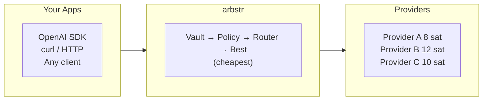

# arbstr

**The cheapest route to any model, metered in sats.**

> **Early-stage software** — under active development. APIs and configuration may change.

arbstr routes AI inference requests to the cheapest qualified provider and meters each request in sats against an agent's balance in [arbstr-vault](https://github.com/johnzilla/arbstr-vault). It combines a Rust routing engine with a treasury service into a single deployable stack. Providers include [mesh-llm](https://docs.anarchai.org) nodes, Routstr endpoints, Ollama instances, Anthropic, or any OpenAI-compatible API. No tokens — just sats.



Multiple providers offer the same models at different rates (priced in satoshis). arbstr exploits these price spreads automatically — free when your local GPU handles it, cheapest cloud provider when it can't.

## Features

- **OpenAI-compatible API** -- drop-in replacement proxy (`/v1/chat/completions`, `/v1/models`); unknown request fields forwarded unchanged
- **Multi-provider routing** -- selects the cheapest available provider per request
- **Auto-discovery** -- providers with `auto_discover = true` have their model lists populated from `/v1/models` at startup (mesh-llm, Ollama, any OpenAI-compatible endpoint)
- **Intelligent complexity routing** -- heuristic scorer routes simple requests to local/free providers, complex ones to frontier; automatic tier escalation on circuit break
- **Vault billing** -- per-request reserve/settle/release against arbstr vault, which enforces each agent's spending policy; fault-tolerant with pending settlement persistence
- **Circuit breakers** -- per-provider Closed/Open/Half-Open with automatic recovery probing
- **Streaming observability** -- SSE token extraction, trailing cost events, post-stream DB updates
- **Policy engine** -- constrain routing by allowed models and max cost; keyword heuristics for auto-matching
- **Secret management** -- SecretString API keys with zeroize-on-drop; env var expansion; convention-based key discovery
- **Cost querying API** -- aggregate stats, time range filtering, paginated request logs
- **Docker image** -- multi-arch (amd64 + arm64) `ghcr.io/johnzilla/arbstr`: `:latest` tracks main, and each [release](https://github.com/johnzilla/arbstr/releases) publishes `:X.Y.Z` with signed build provenance
- **Mock config** -- `--mock` starts with a built-in config of two fake providers, for trying the CLI and endpoints without API keys

## FAQ

[FAQ](FAQ.md) 

## Quick Start

> **Fastest path:** if you just want the full stack running (core + vault + Lightning + Cashu mint) without building from source, use [arbstr-node](https://github.com/johnzilla/arbstr-node) — one `docker compose up`, pre-built images. The instructions below are for working on the core routing engine itself.

```bash
# Clone and build
git clone https://github.com/johnzilla/arbstr.git
cd arbstr
cargo build --release

# Try the CLI and endpoints with a built-in mock config. The mock providers point
# at localhost:9999 and :9998, so chat requests fail unless something serves them.
./target/release/arbstr serve --mock

# Configure real providers
cp config.example.toml config.toml
# Edit config.toml with your providers
./target/release/arbstr serve
```

arbstr listens on `http://localhost:8080` by default. Point any OpenAI-compatible client at it:

```bash
curl http://localhost:8080/v1/chat/completions \
  -H "Content-Type: application/json" \
  -d '{
    "model": "gpt-4o",
    "messages": [{"role": "user", "content": "Hello!"}]
  }'
```

With `[vault]` configured, every request also needs the agent's vault token: add `-H "Authorization: Bearer <agent token>"`. See [Vault billing](#vault-billing).

## Configuration

Copy `config.example.toml` to `config.toml` and customize:

```toml
[server]
listen = "127.0.0.1:8080"
# rate_limit_rps = 100       # optional global rate limit (requests/sec)
# auth_token = "my-secret"   # optional bearer token for /v1/chat/completions, /v1/models, /v1/cost (ignored when [vault] is set)
# operator_token = "${ARBSTR_OPERATOR_TOKEN}"  # bearer token for /v1/stats and /v1/requests (required with [vault])

# Vault treasury integration (optional)
# When configured, requests require vault billing via reserve/settle/release.
# When absent, arbstr runs in free proxy mode (no billing).
# [vault]
# url = "http://localhost:3000"
# internal_token = "${VAULT_INTERNAL_TOKEN}"
# default_reserve_tokens = 4096   # max output tokens for reserve ceiling
# pending_threshold = 100         # max pending settlements before rejecting

# tokenstats market feed (optional) — live quotes from all sources
# [tokenstats]
# url = "https://tokenstats.ai"
# poll_interval_secs = 60
# [tokenstats.keys]
# openrouter = "${OPENROUTER_API_KEY}"
# # "routstr-provider-id" = "${CASHU_TOKEN}"

# Providers -- rates in satoshis per **1M** tokens (RIP-05 / tokenstats)
# mesh-llm local inference (uncomment when mesh-llm is running)
# [[providers]]
# name = "mesh-local"
# url = "http://localhost:9337/v1"
# auto_discover = true         # polls /v1/models at startup
# tier = "local"
# input_rate = 0
# output_rate = 0

[[providers]]
name = "provider-alpha"
url = "https://alpha.routstr.example/v1"
api_key = "${ALPHA_KEY}"       # env var reference (recommended)
models = ["gpt-4o", "claude-3.5-sonnet"]
tier = "frontier"              # local | standard | frontier
input_rate = 10000             # sats per 1M input tokens
output_rate = 30000            # sats per 1M output tokens
base_fee = 1                   # per-request base fee in sats

[[providers]]
name = "provider-beta"
url = "https://beta.routstr.example/v1"
# api_key omitted -- arbstr auto-checks ARBSTR_PROVIDER_BETA_API_KEY
models = ["gpt-4o", "gpt-4o-mini"]
tier = "standard"
input_rate = 8000
output_rate = 35000

# Complexity routing (optional — controls tier selection thresholds)
# Scores below low route to the local tier, above high to frontier, otherwise standard
# [routing]
# complexity_threshold_low = 0.4
# complexity_threshold_high = 0.7

# Routing policies
[policies]
default_strategy = "cheapest"   # only "cheapest" is implemented

[[policies.rules]]
name = "code_generation"
allowed_models = ["claude-3.5-sonnet", "gpt-4o"]
max_sats_per_1m_output = 50000
keywords = ["code", "function", "implement", "debug"]
```

See [`config.example.toml`](./config.example.toml) for a full annotated example.

### tokenstats market feed

When `[tokenstats]` is configured, arbstr polls [tokenstats](https://tokenstats.ai) for live multi-source quotes (OpenRouter, Routstr, …), applies **per-model** rates in sats/1M, and only routes to market providers that have a resolved API key.

```toml
[tokenstats]
url = "https://tokenstats.ai"
poll_interval_secs = 60
allowed_hosts = ["openrouter.ai"]   # hosts market endpoints may use (and receive your keys)
# max_price_sats_per_1m = 1000000   # quotes priced above this are dropped

[tokenstats.keys]
openrouter = "${OPENROUTER_API_KEY}"          # shared for all openrouter quotes
# "a4b35f561ea0" = "${CASHU_FOR_THAT_NODE}"   # by provider_id
```

**The feed is trusted with your keys, so arbstr limits what it can do with them.** The feed chooses each market endpoint's URL, and routing there sends your key as a bearer token. A new market endpoint is used only if it is `https` and its host is in `allowed_hosts` (exact match or a subdomain); otherwise no key is attached and it is skipped. Quotes with a missing, negative or non-finite price, or one above `max_price_sats_per_1m`, are dropped rather than treated as free, which also bounds how far a feed can raise reserves. Static `[[providers]]` are never affected, though the feed can still update their rates within that cap when it quotes the same URL.

`GET /providers` includes a `market` object explaining skipped sources (`missing_api_key`, `low_reliability`, `stale_quotes`, `insecure_endpoint`, `endpoint_not_allowed`, `invalid_price`) so you can see why expected providers are not routable.

### API Key Management

arbstr supports three ways to provide API keys, from most to least recommended:

1. **Convention-based** (recommended) -- omit `api_key` and set `ARBSTR_<UPPER_SNAKE_NAME>_API_KEY`:
   ```bash
   export ARBSTR_PROVIDER_ALPHA_API_KEY="cashuA..."
   ```

2. **Environment variable reference** -- use `${VAR}` syntax in config:
   ```toml
   api_key = "${MY_ROUTSTR_KEY}"
   ```

3. **Literal** (not recommended) -- plaintext in config file. arbstr will warn you:
   ```toml
   api_key = "cashuA..."  # triggers startup warning
   ```

The `check` command reports key status for each provider:
```bash
arbstr check -c config.toml
# Provider key status:
#   provider-alpha: key from convention (ARBSTR_PROVIDER_ALPHA_API_KEY)
#   provider-beta: no key (set ARBSTR_PROVIDER_BETA_API_KEY or add api_key to config)
```

### Policy Matching

Policies are matched in two ways:

1. **Explicit** -- set the `X-Arbstr-Policy` header on your request:
   ```bash
   curl http://localhost:8080/v1/chat/completions \
     -H "X-Arbstr-Policy: code_generation" \
     -H "Content-Type: application/json" \
     -d '{"model": "gpt-4o", "messages": [...]}'
   ```
2. **Heuristic** -- arbstr scans message content for keywords defined in each policy rule and picks the first match.

### Complexity routing

Each request gets a complexity score that picks a tier (`local`, `standard`, `frontier`); if every provider in a tier has an open circuit, arbstr escalates to the next tier. Set `X-Arbstr-Complexity: low | medium | high` to skip the scorer and pick the tier yourself.

## How Routing Works

1. **Request arrives** at the arbstr proxy
2. **Vault reserve** (if configured) -- reserves the estimated cost from the agent's balance. The estimate uses frontier rates and the request's `max_tokens` (or `default_reserve_tokens` when it has none, which arbstr then also sends upstream as `max_tokens`)
3. **Policy matched** via `X-Arbstr-Policy` header or keyword heuristics
4. **Providers filtered** by tier and policy constraints (allowed models, max cost)
5. **Cheapest selected** from remaining providers by blended cost: input and output rates weighted 1:3 (`[tokenstats].blend_ratio`), plus the base fee
6. **Request forwarded** and response streamed back to the client
7. **Vault settle/release** -- settles actual cost on success, releases reservation on failure

## Vault billing

When `[vault]` is configured, arbstr bills every request to an agent account in [arbstr-vault](https://github.com/johnzilla/arbstr-vault). Clients send the agent's vault token as `Authorization: Bearer <token>`; `auth_token` is not used in this mode. `/v1/models` and `/v1/cost` check the token with vault without reserving anything (needs arbstr-vault with `/internal/agents/verify`). Errors use the OpenAI error shape with `"type": "billing_error"` and `"code": "vault_<status>"`:

| Status | Meaning |
|--------|---------|
| `401` | Unknown agent token |
| `402` | Agent balance too low for the reservation |
| `403` | Agent's spending policy refused the request. `error.reason` gives the cause: `exceeds_max_transaction` (set or lower `max_tokens`), `exceeds_daily_limit`, `no_policy_configured` or `deny_all_policy` |
| `429` | Vault rate limited the request |
| `503` | Vault unreachable, or too many settlements are waiting to be retried (`pending_threshold`) |

A misconfigured `internal_token` returns `500`, since that's an operator error, not the client's.

## Response headers

| Header | Value |
|--------|-------|
| `x-arbstr-request-id` | Request id, also used in `/v1/requests` |
| `x-arbstr-provider` | Provider that served the request |
| `x-arbstr-cost-sats` | Actual cost (non-streaming; streaming sends it in a trailing SSE event) |
| `x-arbstr-latency-ms` | Time to response |
| `x-arbstr-streaming` | Whether the response streamed |
| `x-arbstr-retries` | Retries/fallbacks used, when any |
| `x-arbstr-complexity-score`, `x-arbstr-tier` | Complexity score and the tier it selected |

## CLI

```
arbstr serve [OPTIONS]          Start the proxy server
  -c, --config <PATH>           Config file path [default: config.toml]
  -l, --listen <ADDR>           Override listen address
      --mock                    Use a built-in mock config instead of --config

arbstr check [OPTIONS]          Validate configuration
  -c, --config <PATH>           Config file path [default: config.toml]

arbstr providers [OPTIONS]      List configured providers
  -c, --config <PATH>           Config file path [default: config.toml]
```

## API Endpoints

| Endpoint | Auth | Description |
|----------|------|-------------|
| `POST /v1/chat/completions` | client | OpenAI-compatible chat completions (streaming and non-streaming) |
| `GET /v1/models` | client | List available models across all providers |
| `POST /v1/cost` | client | Estimate request cost before sending (input/output token counts and sats) |
| `GET /v1/stats` | operator | Aggregate cost/performance stats with time range and model/provider filtering |
| `GET /v1/stats?group_by=model` | operator | Per-model stats breakdown |
| `GET /v1/stats?group_by=tier` | operator | Per-tier (local/standard/frontier) stats breakdown |
| `GET /v1/requests` | operator | Paginated request log listing with filtering and sorting |
| `GET /health` | none | Health check |
| `GET /providers` | none | List configured providers with rates |

**client**: in free proxy mode, `auth_token` when it is set (open otherwise). With `[vault]`, the agent's vault token.

**operator**: `operator_token`. In free proxy mode, `auth_token` is used when `operator_token` is unset, and the endpoints are open if neither is set. With `[vault]`, they refuse every request (`401 operator_token_not_configured`) until `operator_token` is set, because the request log covers every agent's traffic. `operator_token` accepts `${VAR}`, and an empty value counts as unset.

## Development

See [DEVELOPMENT.md](./DEVELOPMENT.md) for the full development guide including architecture, database schema, and internals.

```bash
cargo test                    # Run all tests
cargo run -- serve --mock     # Run with the built-in mock config
cargo fmt && cargo clippy -- -D warnings  # Format and lint
```

CI (`.github/workflows/ci.yml`) runs `cargo fmt --check`, `cargo clippy -- -D warnings` and `cargo test` on every PR, on Rust 1.99.1. Merges to main also publish `ghcr.io/johnzilla/arbstr:latest` and `:<short-sha>` for amd64 and arm64.

## Roadmap

| Version | Description | Status |
|---------|-------------|--------|
| **v1** | Reliability and observability -- retry with fallback, SQLite logging, response metadata | Shipped |
| **v1.1** | Secrets hardening -- SecretString API keys, env var expansion, key auto-discovery | Shipped |
| **v1.2** | Streaming observability -- SSE token extraction, trailing cost events, stream duration | Shipped |
| **v1.3** | Cost querying API -- aggregate stats, time range filtering, paginated request logs | Shipped |
| **v1.4** | Resilience -- circuit breakers, graceful shutdown, OpenAI field passthrough, multimodal | Shipped |
| **v1.5** | Hardening -- bounded DB writer, indexes, rate limiting, bearer token auth | Shipped |
| **v1.6** | Vault treasury -- reserve/settle/release billing, pending settlement reconciliation | Shipped |
| **v1.7** | Complexity routing -- tier system, heuristic scorer, tier-aware routing, escalation | Shipped |
| **v2.0** | Inference marketplace -- vault billing wiring, mesh-llm auto-discovery, Docker Compose deployment, arbstr.com landing page | Shipped |
| **v2.1.0** | Hardening and releases -- vault policy errors surfaced (403 with reason), reserve estimate covers prompt framing, operator token for stats/logs, vault-verified agent tokens for models/cost, CI with multi-arch images, signed releases with build provenance | Shipped |
| **v2.2.0** | Market feed hardening -- tokenstats keys only go to https endpoints on `allowed_hosts`, quote prices bounded by `max_price_sats_per_1m` (no free/negative quotes, no reserve inflation); new tagline; `.env.example` lists what core reads | Shipped |

## Deployment

### Standalone (free proxy mode)

```bash
cargo build --release
./target/release/arbstr serve -c config.toml

# or with the published image (:latest tracks main; pin a release tag such as :X.Y.Z for anything long-lived)
docker run -p 8080:8080 -v "$PWD/config.toml:/config/config.toml:ro" ghcr.io/johnzilla/arbstr:latest
```

### Full stack (with billing)

Use [arbstr-node](https://github.com/johnzilla/arbstr-node) for the complete stack: core routing engine, vault treasury, Lightning (LND), and Cashu mint.

```bash
git clone https://github.com/johnzilla/arbstr-node && cd arbstr-node
cp .env.example .env   # fill in secrets
docker compose up -d
```

Your inference proxy is live at `http://localhost:8080`. Before the first request, create and fund an agent and set its spending policy — the [arbstr-node README](https://github.com/johnzilla/arbstr-node#create-an-agent) walks through it.

## Related Projects

- [arbstr](https://github.com/johnzilla/arbstr) -- Routing engine: OpenAI-compatible proxy that picks the cheapest qualified provider
- [arbstr-vault](https://github.com/johnzilla/arbstr-vault) -- Treasury: agent accounts, spending policy, per-request billing, Lightning and Cashu rails
- [arbstr-node](https://github.com/johnzilla/arbstr-node) -- The full stack (core + vault + LND + Cashu mint) as one `docker compose up`, pinned to released versions
- [mesh-llm](https://docs.anarchai.org) -- Distributed P2P inference network (local provider)
- [Routstr](https://routstr.com) -- Decentralized LLM marketplace

## Contributing

This project is being built in public. See [CONTRIBUTING.md](./CONTRIBUTING.md) for development setup and contribution guidelines.

## License

Copyright (c) 2026 arbstr contributors

Licensed under the [MIT License](./LICENSE). You are free to use, modify, and distribute this software. See the LICENSE file for full terms.
